# Scientific Figure Generation with Vibe Coding

**Vibe Coding in Medical Imaging (VCMI) · MICCAI 2026 · Stand #5**

Explore how AI coding assistants can help generate, refine, and verify scientific figures for medical imaging research. This 20–25 minute stand moves from dataset summaries to results figures, then opens a discussion about method diagrams and flowcharts.

A useful reference figure can make a substantial difference to the final result. The goal is to understand its design choices, adapt them to your own data, and check that the resulting figure communicates the evidence accurately.

Visual preferences vary, but readable labels, faithful data, clear comparisons, and reproducible code give us common criteria for judging a figure.

[Explore the gallery](https://VibeCodingMICCAI.github.io/stand4_scientific_figure/gallery/) · [Submit a figure](https://github.com/VibeCodingMICCAI/stand4_scientific_figure/issues/new?template=figure-submission.yml) · [Website setup](WEBSITE.md)

## 1. Introducing a dataset

Suppose you are building a foundation model using data from several tasks and imaging modalities. How would you summarize the data so readers can understand its breadth and composition?

The table below provides the counts used in this exercise. They are **approximate values estimated from a reference figure**, not verified counts from the original datasets. Repeated dataset names appear under different tasks, and the counting units are not established for every entry. Their sum should therefore not be interpreted as a count of unique patients or images. Use verified source data for a paper.

[Download the example CSV](sample-datasets/foundation_model_dataset.csv)

Abbreviations: **MRG**, medical report generation; **VQA**, visual question answering; **WSI**, whole-slide image; **DSC**, Dice similarity coefficient.

<details>
<summary><strong>View the full dataset table</strong></summary>

| Task | Modality | Dataset | Approx. count |
|---|---|---|---:|
| Diagnosis | X-Ray | SIIM-ACR | 1,300 |
| Diagnosis | X-Ray | Covid-CXR2 | 4,800 |
| Diagnosis | X-Ray | NLM-TB | 160 |
| Diagnosis | X-Ray | MedFMC (Chest) | 340 |
| Diagnosis | X-Ray | VinDr-PCXR | 2,100 |
| Diagnosis | X-Ray | VinDr-CXR | 3,300 |
| Diagnosis | X-Ray | RSNA | 1,900 |
| Diagnosis | X-Ray | VinDr-SpineXR | 2,500 |
| Diagnosis | X-Ray | NIH ChestX-ray14 | 39,000 |
| Diagnosis | X-Ray | CheXpert | 49,000 |
| Diagnosis | Fundus | RFMiD2 | 150 |
| Diagnosis | Fundus | DRD | 90,000 |
| Diagnosis | Fundus | Fundus JSIEC | 170 |
| Diagnosis | Fundus | ODIR | 2,000 |
| Diagnosis | Pathology | LC25000 (Colon) | 2,400 |
| Diagnosis | Pathology | LC25000 (Lung) | 3,100 |
| Diagnosis | Pathology | MedFMC (Colon) | 1,800 |
| Diagnosis | Pathology | PCam200 | 30,000 |
| Diagnosis | Endoscopy | MedFMC (Endo) | 260 |
| Diagnosis | Endoscopy | WCE | 930 |
| Diagnosis | Endoscopy | HyperKvasir | 2,400 |
| Diagnosis | Endoscopy | Kvasir | 2,000 |
| Diagnosis | Mammography | VinDr-Mammo | 4,100 |
| Diagnosis | Mammography | DDSM | 27,000 |
| Diagnosis | Mammography | Breast Cancer | 250 |
| Diagnosis | Dermatology | HAM10000 | 2,000 |
| Diagnosis | Dermatology | PAD-UFES-20 | 340 |
| Diagnosis | Ultrasound | BUSBRA | 280 |
| Diagnosis | Ultrasound | UBIBC | 930 |
| Diagnosis | Ultrasound | BUID | 140 |
| Diagnosis | Ultrasound | HMC-QU | 2,500 |
| Diagnosis | OCT | OCTMNIST | 1,700 |
| Diagnosis | OCT | Retinal OCT | 2,800 |
| Diagnosis | MRI | Breast Tumor MRI | 1,900 |
| Diagnosis | MRI | Brain Tumor MRI | 1,700 |
| Diagnosis | CT | Brain Tumor CT | 1,300 |
| Diagnosis | CT | COVIDxCT | 46,000 |
| Retrieval | Mixture | PMC-9k | 61,000 |
| Retrieval | Pathology | Quilt-1M | 80,000 |
| MRG | X-Ray | MIMIC-CXR | 85,000 |
| MRG | X-Ray | IU X-Ray | 4,100 |
| VQA | Radiology | VQA-RAD | 5,100 |
| VQA | Radiology | SLAKE | 90,000 |
| WSI Analysis | Pathology | BRACS-3 | 530 |
| WSI Analysis | Pathology | BRACS-7 | 530 |
| WSI Analysis | Pathology | BRCA | 90,000 |
| WSI Analysis | Pathology | NSCLC | 80,000 |
| WSI Analysis | Pathology | Camelyon | 31,000 |
| WSI Analysis | Pathology | LUAD | 8,900 |
| WSI Analysis | Pathology | LUSC | 8,400 |
| Explainable AI | Dermatology | Derm7pt | 2,400 |
| Explainable AI | Dermatology | SkinCon | 1,800 |
| Explainable AI | Pathology | WBCAttr | 95,000 |
| Explainable AI | Pathology | MedFMC (Colon) | 39,000 |
| Explainable AI | Ultrasound | BrEaST | 100 |
| Explainable AI | Ultrasound | UBIBC | 15,000 |
| Explainable AI | CT | LUNA16 | 830 |
| Explainable AI | CT | NLM-TB | 780 |
| Explainable AI | X-Ray | VinDr-PCXR | 37,000 |
| Explainable AI | X-Ray | VinDr-CXR | 12,000 |
| Explainable AI | X-Ray | RSNA | 37,000 |
| Explainable AI | Mammography | CBIS-DDSM | 1,700 |


</details>

### Choose a chart that fits the question

Bar charts, line charts, and pie charts answer different questions. A line chart shows a trend over an ordered variable; a bar chart compares magnitudes; a pie chart summarizes parts of a whole. Choose the representation according to what you want readers to compare.

The dataset examples below were generated using `GPT-6.1-sol-high`.

> Could you help me plot this table using Python and Matplotlib?

<details>
<summary><strong>Example: leaving the chart type unspecified</strong></summary>

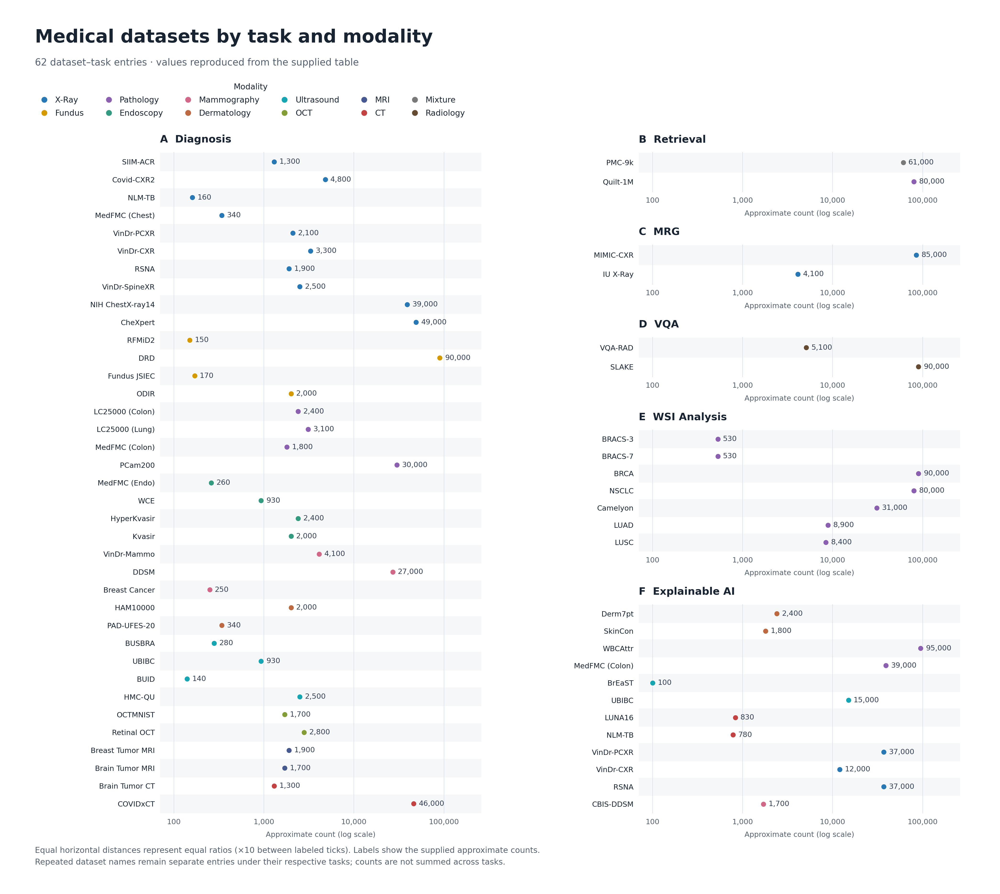

The individual entries are readable, but the figure occupies considerable space. For a paper, consider whether this level of detail is needed in the main figure or belongs in a supplementary table.

[Plotting code](scripts/dataset-unspecified-type.py)

</details>

> Could you help me summarize this table as a pie chart using Python and Matplotlib?

<details>
<summary><strong>Example: grouping the counts by task</strong></summary>

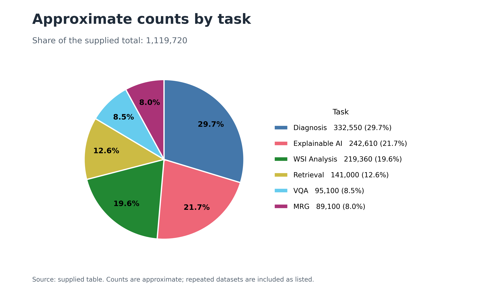

This view is compact, but it hides the distribution across modalities and individual datasets. Its proportions describe the supplied table entries, including repeated datasets; they do not establish the composition of a deduplicated training set.

[Plotting code](scripts/dataset-pie-task.py)

</details>

### State the takeaway in one sentence

Before asking an assistant to draw a figure, decide what you want readers to learn. For example:

> The pretraining collection covers multiple imaging modalities and multiple tasks.

A modality-level summary communicates a different aspect of the collection:

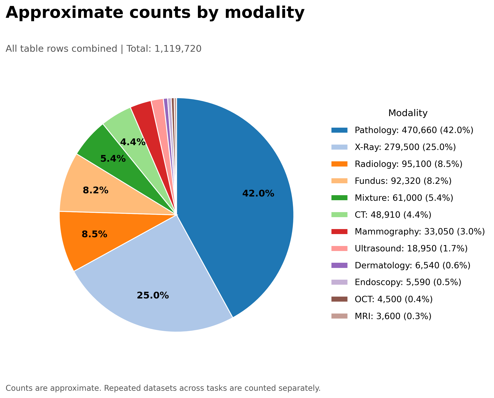

[Plotting code](scripts/dataset-pie-modality.py)

Can one figure show tasks, modalities, and individual datasets together? It can, but the additional detail must remain readable at the figure's final size. A familiar hierarchical layout can provide a useful starting point.

### Learn from a good reference

Give the assistant a reference figure and explain which features you want to adapt: grouping, layout, typography, color meanings, or annotation style.

> Use the attached figure as a design reference. Create a similar dataset-composition figure from the supplied table using Python and Matplotlib. Preserve the data and labels, adapt the layout to our categories, and flag any missing information.

**Reference 1: MerMED-FM**

Zhou, Y., Quek, C. W. N., Zhou, J., et al. *MerMED-FM: Multimodal, Multi-Disease Medical Imaging Foundation Model.* The Lancet Digital Health (2026). [Paper](https://doi.org/10.1016/j.landig.2026.101007).

**Original reference figure**

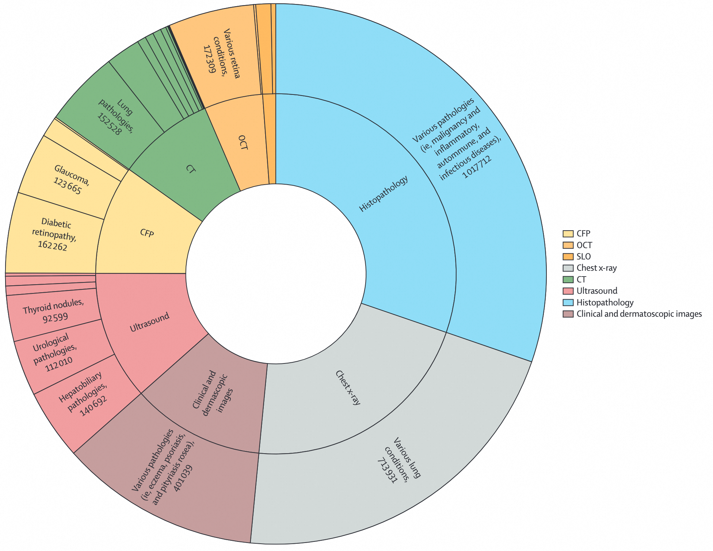

**Adaptation using the example table and `GPT-6.1-sol-high`**

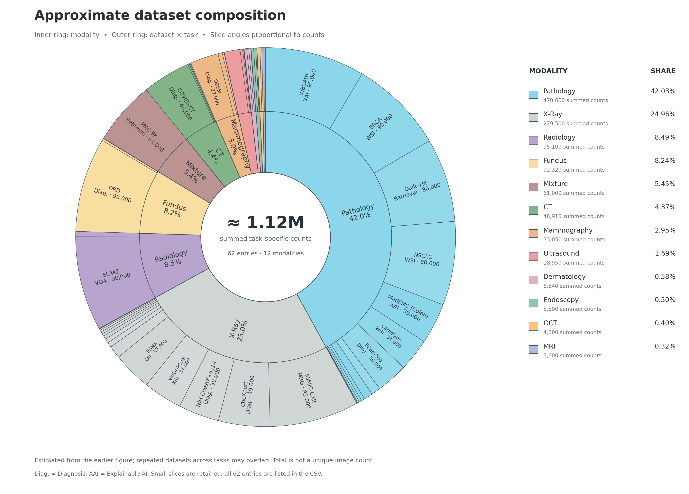

[Plotting code](scripts/dataset-ref1-reprod.py)

This is a design adaptation using the exercise's approximate counts, rather than a reproduction of MerMED-FM's underlying dataset statistics.

**Reference 2: Concept-enhanced vision–language pretraining**

Nie, Y., He, S., Bie, Y., et al. *An explainable biomedical foundation model via large-scale concept-enhanced vision–language pretraining.* Nature Biomedical Engineering (2026). [Paper](https://doi.org/10.1038/s41551-026-01764-x).

**Original reference figure**

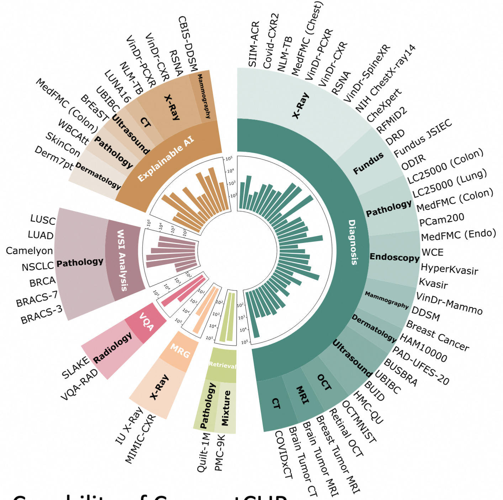

**Reconstruction using approximate image-derived values and `GPT-6.1-sol-high`**

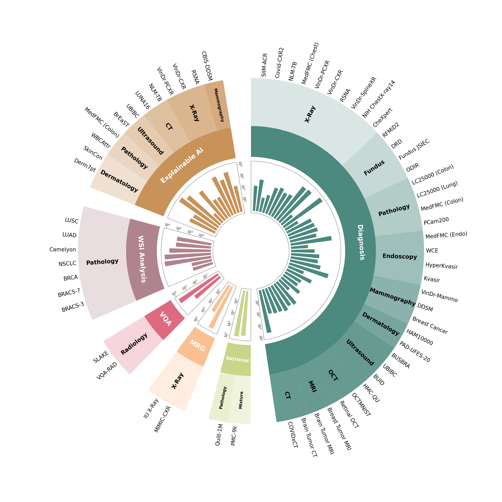

[Plotting code](scripts/dataset-ref2-reprod.py)

The reconstruction script estimates counts from measured bar radii and a logarithmic calibration. This is a visual reconstruction with approximate data, not an exact numerical reproduction. A screenshot can guide layout, but reliable numerical reproduction requires source data.

## 2. Presenting results

A results figure should make the intended comparison easy to understand while preserving the meaning of the measurements. The following examples show how targeted annotations can help.

### Choose the comparison before choosing the chart

Yue, Y., et al. *Does Reinforcement Learning Really Incentivize Reasoning Capacity in LLMs Beyond the Base Model?* NeurIPS 2025. [Paper](https://arxiv.org/abs/2504.13837).

This example compares base models with reinforcement-learning-trained variants at different sampling budgets. **Pass@k** measures the probability of obtaining at least one correct answer among k generated answers under the evaluation procedure. The plotted results show an advantage for the RL variants at small k, while the base models can overtake them at larger k.

**Initial presentation**

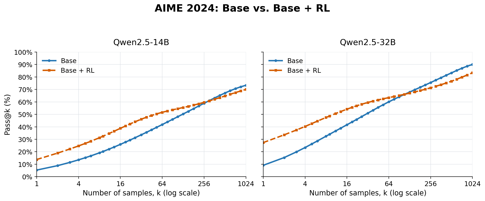

[Plotting code](scripts/result-comparison-before.py)

**Refined presentation**

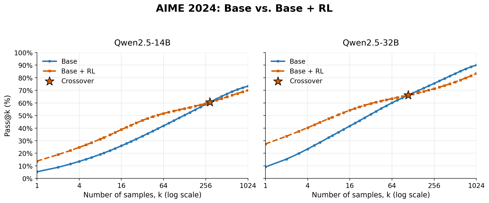

[Plotting code](scripts/result-comparison-after.py)

Crossover markers direct attention to where the relative ordering changes. The script interpolates between sampled points in log(k), so the marked locations are visual estimates rather than separately evaluated experimental thresholds. This pattern describes these evaluations; it does not establish that every RL model behaves the same way.

[14B example data](sample-datasets/aime24_qwen2_5_14b.csv) · [32B example data](sample-datasets/aime24_qwen2_5_32b.csv)

### Use annotations to reduce the reader's effort

Li, W., et al. *CancerVerse: A Fully Open Longitudinal and Multimodal Dataset for Multicancer Screening.* MICCAI 2026. [Paper, Figure 3a](https://papers.miccai.org/miccai-2026/paper/0562_paper.pdf).

Consider these segmentation results:

| Training strategy | Mean DSC (%) | Gain over image-only (percentage points) |
|---|---:|---:|
| Image-only | 48.7 | — |
| Multimodal | 49.0 | +0.3 |
| Longitudinal | 50.6 | +1.9 |
| Longitudinal and multimodal | **51.1** | **+2.4** |

**Initial presentation**

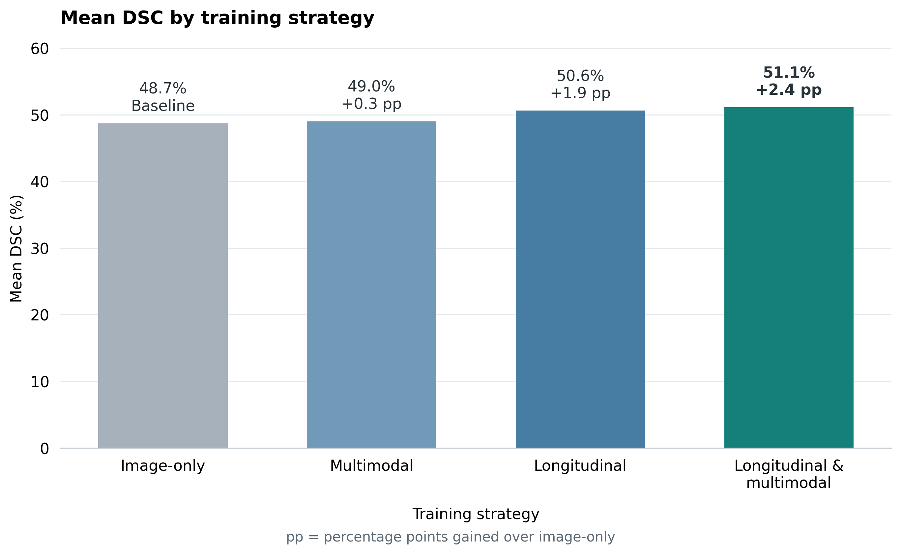

The differences are small enough that readers need to compare the bars carefully. Explicit gain labels can make the intended comparison easier to follow.

**Refined presentation inspired by Figure 3a**

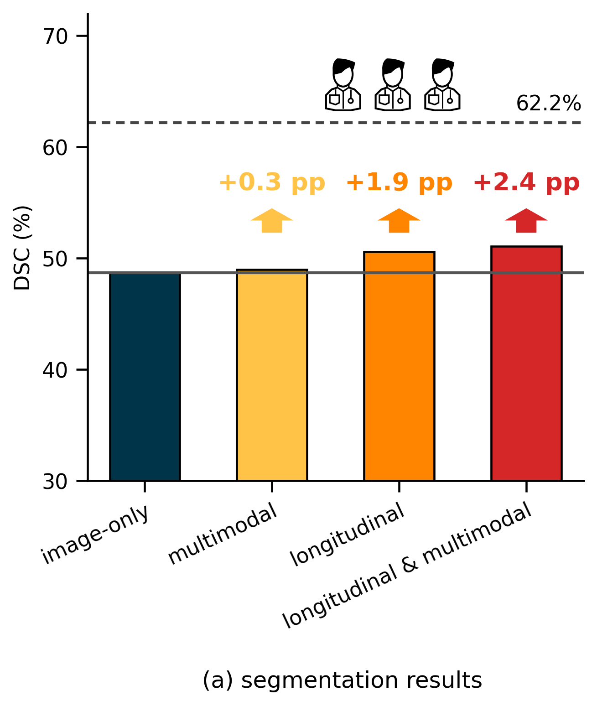

[Plotting code](scripts/result-resolve-burden.py)

The gain from 48.7% to 51.1% is **2.4 percentage points**, not a 2.4% relative improvement. The dashed 62.2% line represents radiologist inter-annotator agreement on a smaller subset, whereas the four model scores summarize the full test set. On that same smaller subset, the paper reports a model DSC of 50.8%. The line provides context; it is not a directly comparable full-test-set baseline.

The refined chart follows the reference's cropped y-axis. Cropping a bar chart exaggerates differences in visible bar lengths. For a new paper figure, consider a zero-based bar chart with gain labels, or a dot plot with clearly labeled limits. No uncertainty estimates are available in this example table, so the chart should not invent error bars or significance claims.

### Check the figure before using it

- Check plotted values, units, aggregation, and sample counts against the input.
- Define uncertainty bars and preserve pairing when methods share evaluation cases.
- Keep colors, category order, and scales consistent across comparable panels.
- Inspect the exported figure at its intended paper size.
- Keep the input data, plotting script, and exported figure together.

## 3. Discussing method diagrams and flowcharts

Method overviews require both a correct scientific structure and a clear visual layout. Before drawing, ask the assistant to list the modules, inputs, outputs, and directed relationships, using the figure caption and relevant methods text as evidence.

> First identify the modules and connections. Distinguish forward computation, supervision, and parameter updates. Separate training from inference and flag ambiguous relationships. Then propose an editable layout that emphasizes the method's main contribution.

During refinement, check arrow meanings, frozen and trainable modules, grouping, and image assets. A diagram can look polished while communicating an incorrect method. Use editable text, shapes, and connectors so scientific corrections and final layout adjustments remain practical.

## Figures with Code: a community gallery

A useful reference can help us choose a layout, improve annotations, and communicate a scientific result. **Figures with Code** collects reference figures alongside adaptations or reproductions, plotting code, and explanations of the design choices.

[Explore the gallery](https://VibeCodingMICCAI.github.io/stand4_scientific_figure/gallery/)

To contribute, [open a figure-submission issue](https://github.com/VibeCodingMICCAI/stand4_scientific_figure/issues/new?template=figure-submission.yml) or submit a pull request. Include:

- The paper title, citation or DOI, and figure number or panel.
- The reference figure and your adapted or reproduced output.
- The plotting code, dependencies, and data source or a clearly labeled example dataset.
- What makes the reference useful, what you changed, and any remaining differences.
- Whether you are an original author sharing your own figure code.

Maintainers review submissions before adding them to the gallery. Original-author contributions can be credited explicitly after confirmation. Attribute source figures to their creators and include reuse or license information when available. Review contributed code before running it.

## Continue exploring

Scan the QR code to visit the community destination, or use the links above.


## Run the examples

Install the plotting dependencies:

```bash
python -m pip install matplotlib numpy pandas
```

Run the reference-based dataset adaptation:

```bash
python scripts/dataset-ref1-reprod.py --input sample-datasets/foundation_model_dataset.csv --outdir output/dataset
```

Run the annotated results example:

```bash
python scripts/result-comparison-after.py --data-dir sample-datasets --output output/aime24-annotated.png
```

For local website preview and GitHub Pages setup, see [WEBSITE.md](WEBSITE.md).

## Acknowledgements

- [figures4papers](https://github.com/ChenLiu-1996/figures4papers): scientific figure examples and an agent skill.
- [Tutorial on improving scientific figures](https://www.youtube.com/watch?v=KQ6Zg9B5Mxs).
- [SciencePlots](https://github.com/garrettj403/SciencePlots): Matplotlib styles for scientific figures.
